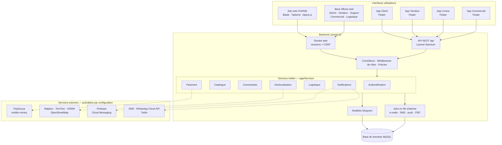
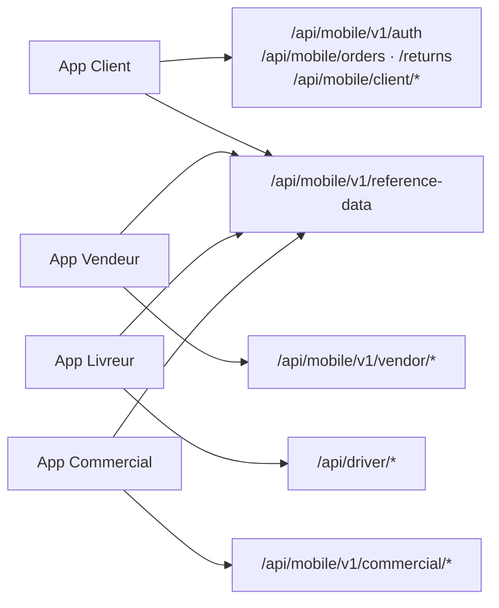

# OVANIE — Écosystème digital du BTP

OVANIE est une plateforme numérique dédiée au commerce des matériaux, équipements et services du bâtiment et des travaux publics (BTP) en Côte d'Ivoire. Elle réunit dans un même système une marketplace e-commerce, des espaces vendeurs, une chaîne logistique de livraison, des outils de prospection commerciale, un service client et quatre applications mobiles spécialisées.

> **Statut : En développement — préparation à la production.**
> Les parcours principaux sont implémentés et couverts par des tests automatisés. Plusieurs intégrations externes (paiement en ligne, SMS, WhatsApp, téléphonie, IA) sont présentes dans le code mais **désactivées par défaut** tant que leur recette n'est pas validée. Voir [État d'avancement](#11-état-davancement).

---

## Sommaire

1. [Présentation du projet](#1-présentation-du-projet)
2. [Vision et écosystème](#2-vision-et-écosystème)
3. [Architecture générale](#3-architecture-générale)
4. [Technologies utilisées](#4-technologies-utilisées)
5. [Applications mobiles](#5-applications-mobiles)
6. [Fonctionnalités métier principales](#6-fonctionnalités-métier-principales)
7. [Architecture logistique](#7-architecture-logistique)
8. [Organisation du dépôt](#8-organisation-du-dépôt)
9. [Installation et configuration locale](#9-installation-et-configuration-locale)
10. [Sécurité et qualité](#10-sécurité-et-qualité)
11. [État d'avancement](#11-état-davancement)
12. [Documentation complémentaire](#12-documentation-complémentaire)
13. [Auteur](#13-auteur)
14. [Licence et utilisation](#14-licence-et-utilisation)

---

## 1. Présentation du projet

L'achat de matériaux de construction reste largement informel : prix difficiles à comparer, disponibilité incertaine, livraison de produits lourds ou volumineux mal organisée, peu de traçabilité des paiements et des commandes.

OVANIE cherche à répondre à ces problèmes concrets :

| Problème métier | Réponse apportée par la plateforme |
|---|---|
| Offre dispersée entre de nombreux revendeurs | Marketplace multi-vendeurs avec catalogue structuré par catégories BTP |
| Prix et disponibilités opaques | Fiches produits, stocks, promotions et négociation de prix |
| Livraison de charges lourdes ou encombrantes | Calcul des frais selon poids, volume, distance et véhicule requis |
| Commandes réparties chez plusieurs vendeurs | Regroupement des expéditions et optimisation du panier |
| Besoins professionnels en volume | Offres business, demandes de devis et appels d'offres |
| Faible traçabilité | Suivi de commande, suivi GPS des livraisons, confirmation par code OTP |
| Recrutement et accompagnement des vendeurs | Application et back-office dédiés aux commerciaux terrain |

---

## 2. Vision et écosystème

OVANIE est conçu comme un ensemble d'interfaces différentes qui partagent un **backend unique** et les **mêmes données métier**.

| Composante | Rôle | Interfaces |
|---|---|---|
| **OVANIE (marketplace)** | Recherche, comparaison et achat de produits BTP par les particuliers et les entreprises | Site web, application Client |
| **OVANIE Business** | Achats professionnels : offres en volume (quantité minimale, délai, zone), demandes de devis, appels d'offres, négociation | Site web, API |
| **OVANIE Logistics** | Tarification, planification et supervision des livraisons, partenaires de livraison | Back-office Logistique, application Livreur, espace livreur web |
| **Espace vendeur** | Gestion de la boutique, du catalogue, des commandes, des retours et des reversements | Espace vendeur web, application Vendeur |
| **Administration** | Validation des vendeurs, catalogue de référence, commissions, promotions, paiements, utilisateurs | Back-office Admin |
| **Service client** | Tickets, conversations, rappels, litiges, base de connaissances | Back-office Support, centre d'aide client |
| **Prospection commerciale** | Missions de prospection par quartier, ouverture de boutiques, suivi des prospects | Back-office Commercial, application Commercial |

> Les modules **web** (Blade, servis par Laravel) et les applications **mobiles** (Flutter) sont des projets distincts. Les applications mobiles ne contiennent aucune logique métier critique : elles consomment l'API REST Laravel.

---

## 3. Architecture générale



**Principes structurants**

- **Un seul backend, plusieurs interfaces** : le site web et les quatre applications lisent et écrivent les mêmes commandes, produits, boutiques et livraisons.
- **Logique métier dans les services** : les contrôleurs web et API délèguent aux classes de `laravel/app/Services/` (tarification, workflow de commande, reversements, suivi…), ce qui garantit des règles identiques sur tous les canaux.
- **Contrat de données commun web ↔ mobile** : un registre de données de référence (catégories, statuts, communes, véhicules…) est exposé par `GET /api/mobile/v1/reference-data` et documenté dans [`laravel/docs/socle-commun/`](laravel/docs/socle-commun/).
- **Traitements asynchrones** : notifications, SMS, e-mails et génération de PDF passent par des jobs Laravel (`QUEUE_CONNECTION=database`).

### Correspondance applications ↔ API



---

## 4. Technologies utilisées

### Backend

| Technologie | Version / usage vérifié |
|---|---|
| PHP | `^8.2` |
| Laravel | `^12.0` — routes web et API, files d'attente, planificateur, notifications |
| Eloquent ORM | Modèles dans `laravel/app/Models/`, migrations dans `laravel/database/migrations/` |
| Laravel Sanctum | Authentification par jeton des applications mobiles (`auth:sanctum`) |
| Laravel Socialite | Connexion Google sur le site web (`/login/google`), nécessite des identifiants OAuth |
| barryvdh/laravel-dompdf | Génération de documents PDF (factures de commande) |
| PHPUnit 11 | Tests automatisés |

### Frontend web

| Technologie | Usage vérifié |
|---|---|
| Laravel Blade | Rendu de toutes les pages publiques et des back-offices |
| JavaScript | Scripts applicatifs dans `laravel/resources/js/` |
| Tailwind CSS | Styles utilitaires (`tailwind.config.js`, plugin `@tailwindcss/forms`) |
| Alpine.js | Interactions côté client, importé dans `resources/js/app.js` |
| Vite 7 | Compilation des ressources (`laravel-vite-plugin`) |
| Leaflet · Mapbox GL | Cartes web (sélection d'emplacement, suivi de livraison, logistique) |

### Mobile

| Technologie | Usage vérifié |
|---|---|
| Flutter / Dart | SDK Dart `>=3.9` pour les quatre applications |
| `dio` | Client HTTP vers l'API Laravel (toutes les applications) |
| `geolocator` | Géolocalisation (toutes les applications) |
| `flutter_map` | Cartes OpenStreetMap — application Client |
| `mapbox_maps_flutter` | Cartographie et suivi de mission — application Livreur |
| `firebase_core`, `firebase_messaging` | Notifications push — application Client |
| `image_picker`, `file_picker`, `camera` | Photos produits, justificatifs, documents |
| `flutter_secure_storage` | Stockage sécurisé de session — application Commercial |
| `shared_preferences` | Préférences locales — application Livreur |
| `webview_flutter`, `open_filex`, `path_provider` | Paiement web, ouverture de factures — application Client |

### Données

| Moteur | Usage |
|---|---|
| MySQL | Base principale (`DB_CONNECTION=mysql` dans `.env.example`) |
| SQLite en mémoire | Exécution des tests (`phpunit.xml`) |
| Base de données Laravel | Sessions, cache et files d'attente (`database`) |

### Services externes

Toutes ces intégrations sont **présentes dans le code et pilotées par le fichier `.env`**. Leur présence ne signifie pas qu'elles sont actives : la plupart sont désactivées par défaut.

| Domaine | Service | État dans la configuration par défaut |
|---|---|---|
| Paiement | PayDunya (Orange Money, MTN, Moov, Wave) | Désactivé (`PAYDUNYA_ENABLED=false`) |
| Paiement | Wave, Flutterwave | Code et configuration présents, non proposés au checkout |
| Cartographie | Mapbox (cartes, géocodage), TomTom ou OSRM (itinéraires) | Nécessite des clés d'API |
| Notifications push | Firebase Cloud Messaging | Nécessite un projet Firebase (fichiers de configuration non versionnés) |
| SMS | AllMySMS (pilote SMS interchangeable) | Désactivé (`SMS_ENABLED=false`) |
| Messagerie | WhatsApp Cloud API (Meta) | Désactivé (`SUPPORT_WHATSAPP_ENABLED=false`) |
| Téléphonie | Twilio | Désactivé (`SUPPORT_TELEPHONY_PROVIDER=none`) |
| Assistance IA | Fournisseur configurable (Anthropic, OpenAI) | Nécessite une clé d'API |

---

## 5. Applications mobiles

Les quatre applications se trouvent dans [`OVANIE-MOBILE/`](OVANIE-MOBILE/). Chacune est un projet Flutter autonome, organisé par fonctionnalités (`lib/features/<module>/`) et configuré par variables de compilation (`OVANIE_ENV`, `OVANIE_API_BASE`).

### Application Client — `ovanie_app`

Application d'achat destinée aux particuliers et aux professionnels.

| Module | Fonctionnalités présentes |
|---|---|
| Accueil et catalogue | Accueil, nouveautés, meilleures ventes, ventes flash, collections d'offres |
| Catégories et recherche | Catégories, sous-catégories, recherche de produits |
| Produits | Fiche produit, collections, produits récemment consultés |
| Panier | Panier synchronisé avec le serveur |
| Checkout | Adresse de livraison sur carte, sélection de la commune, frais de livraison, choix du paiement, confirmation |
| Commandes | Liste, détail, facture, annulation, confirmation de réception, nouvelle commande |
| Paiements | Historique, reprise d'un paiement, moyens de paiement enregistrés |
| Livraison et suivi | Suivi de livraison avec carte en direct |
| Après-vente | Demandes de retour, avis et notes |
| Compte client | Profil, adresses, favoris, listes d'envies, fidélité, notifications, sécurité, suppression du compte, documents légaux |
| Support | Centre d'aide, tickets, conversations, accès WhatsApp |

### Application Vendeur — `ovanie_vendor`

Application de gestion destinée aux vendeurs de la marketplace. Elle utilise exclusivement l'API `/api/mobile/v1/vendor`.

| Module | Fonctionnalités présentes |
|---|---|
| Authentification | Connexion, inscription, mot de passe oublié, parcours d'accueil vendeur |
| Boutique | Ouverture de boutique guidée, profil de boutique |
| Catalogue produits | Liste, création, modification, images, archivage |
| Commandes | Liste, détail, préparation, expédition, suivi de livraison |
| Après-vente | Retours et litiges |
| Finances | Synthèse financière, reversements et suivi des reversements |
| Notifications | Centre de notifications vendeur |
| Paramètres | Réglages de livraison et de logistique, profil, avis clients, statistiques |

### Application Livreur — `ovanie_livreur`

Application destinée aux livreurs partenaires, utilisant l'API `/api/driver`.

| Module | Fonctionnalités présentes |
|---|---|
| Inscription | Vérification du numéro, informations personnelles, véhicule et catégorie, zones couvertes, disponibilités |
| Authentification | Connexion avec vérification par code OTP |
| Profil et véhicule | Profil du livreur, informations du véhicule |
| Présence | Passage en ligne / hors ligne, disponibilité |
| Missions | Liste des missions, détail, acceptation ou refus |
| Retrait | Départ, collecte des colis chez le ou les vendeurs |
| Livraison | Étapes de livraison, confirmation par code OTP du client, signalement d'incident |
| Navigation et suivi | Carte Mapbox, envoi de la position GPS pendant la mission |
| Historique | Historique et détail des missions terminées |

### Application Commercial — `ovanie_commercial`

Application terrain destinée aux commerciaux chargés d'accompagner les vendeurs, utilisant l'API `/api/mobile/v1/commercial`.

| Module | Fonctionnalités présentes |
|---|---|
| Tableau de bord | Indicateurs d'activité du commercial |
| Prospection | Missions de prospection par quartier (démarrage, clôture), prospects, visites |
| Clients | Liste et création de clients |
| Boutiques | Ouverture de boutique sur le terrain avec géolocalisation, détail des boutiques |
| Produits | Saisie de produits pour les boutiques accompagnées, brouillons |
| Menu | Profil, notifications, préférences, synchronisation, boutiques visitées |

---

## 6. Fonctionnalités métier principales

### Catalogue et produits
Catalogue structuré en catégories et sous-catégories BTP, fiches produits avec images, stock et prix promotionnels. Le back-office gère un référentiel de produits, les catégories et leur reclassement. Un calculateur de matériaux estime des quantités et peut ajouter le résultat au panier.

### Marketplace et commandes
Panier invité ou connecté, checkout en plusieurs étapes, commandes réparties par vendeur, réservation de stock, chronologie de commande, factures PDF, annulation et confirmation de réception par le client. Le workflow vendeur (acceptation, préparation, expédition) est centralisé dans des services dédiés.

### Vendeurs et boutiques
Ouverture de boutique, dépôt et validation de documents par l'administration, statut d'approbation, réglages logistiques (point de retrait géolocalisé), gestion du catalogue, des commandes, des retours, des avis et des reversements.

### Paiements
Au checkout, trois modes sont prévus : **paiement en ligne via PayDunya** (mobile money), **paiement à la livraison** et **virement bancaire**. Le paiement en ligne reste désactivé tant que les clés PayDunya ne sont pas configurées. Les commissions marketplace et les reversements aux vendeurs et aux livreurs sont calculés côté serveur.

### Gestion administrative
Tableau de bord, gestion des utilisateurs et du personnel, validation des vendeurs et de leurs documents, commissions, promotions et bannières, cartes cadeaux, vérification des paiements, export des reversements.

### Logistique et tarification
Moteur de tarification, catégories de véhicules, tournées, partenaires de livraison et supervision. Voir [Architecture logistique](#7-architecture-logistique).

### Géolocalisation
Référentiel des localités d'Abidjan, géocodage, calcul d'itinéraires, validation des coordonnées de livraison et suivi GPS des livreurs. Les fournisseurs (Mapbox, TomTom, OSRM) sont interchangeables par configuration.

### Prospection commerciale
Missions de prospection découpées par quartier, prospects et visites, ouverture de boutiques et saisie rapide de produits par les commerciaux, suivi depuis un back-office Commercial.

### Service client
Back-office Support : tickets, conversations, rappels, transferts vers un agent humain, consultation des commandes, paiements, livraisons, retours et litiges, base de connaissances. Un assistant IA de support et des canaux WhatsApp et téléphonie sont implémentés mais désactivés par défaut ; leurs décisions sont journalisées pour supervision.

### Devis et achats professionnels
Offres business (catalogue ou sur demande, quantité minimale, délai, zone), demandes de devis, appels d'offres avec pièces jointes et négociation de prix sur les produits. Ces fonctionnalités sont exposées sur le site web et par l'API.

### Notifications
Dispatcher central de notifications (base de données, e-mail, SMS, push Firebase) exécuté en file d'attente. L'envoi effectif dépend de la configuration de chaque canal.

### Retours, remboursements et litiges
Demandes de retour avec justificatifs, traitement par le vendeur, service de remboursement, litiges vendeur et suivi par le support.

---

## 7. Architecture logistique

**OVANIE Logistics** coordonne la livraison de produits souvent lourds et volumineux. OVANIE ne dispose pas d'une flotte salariée : les livraisons sont réalisées par des **livreurs indépendants inscrits via l'application Livreur**, par des **transporteurs partenaires**, ou par le **vendeur lui-même**, avec supervision par la plateforme.

```mermaid
flowchart LR
    CART["Panier client"] --> OPT["Optimisation du panier<br/>produits équivalents"]
    OPT --> GRP["Regroupement<br/>par point de retrait"]
    GRP --> MET["Poids · volume · distance<br/>commune de destination"]
    MET --> VEH["Choix du véhicule<br/>Moto → Camion 10T"]
    VEH --> FEE["Frais de livraison"]
    FEE --> ORD["Commande payée"]
    ORD --> MIS["Mission de livraison"]
    MIS --> DRV["Livreur partenaire<br/>ou transporteur · vendeur"]
    DRV --> TRK["Suivi GPS<br/>détection d'arrivée"]
    TRK --> OTP["Remise confirmée<br/>par code OTP"]
```



| Mécanisme | Implémentation |
|---|---|
| **Calcul des frais** | `DeliveryPricingEngine` et `OvanieDeliveryPriceCalculator` combinent poids, volume, distance, commune de destination, caractère fragile et véhicule requis. Les grilles sont paramétrées en back-office et ne figurent pas dans le code. |
| **Distances** | Matrice de distances entre communes et calcul d'itinéraire via le fournisseur de routage configuré. |
| **Poids et volumes** | Agrégés par expédition à partir des caractéristiques des produits. |
| **Catégories de véhicules** | Moto, Tricycle, Pickup, Camion 3T, Camion 10T — sélection automatique selon la charge (`LogisticsVehicleResolver`). |
| **Missions de livraison** | Proposition des missions aux livreurs, acceptation ou refus, départ, collectes multiples, étapes de livraison, incidents (`DriverMissionService`). |
| **Partenaires de livraison** | Transporteurs avec zones de couverture, répartition de flotte et historique de missions (`LogisticsPartnerService`). |
| **Livraison par le vendeur** | Lien de mission sécurisé permettant au livreur du vendeur de partager sa position et de valider la remise. |
| **Suivi** | Positions GPS, détection automatique d'arrivée, présence des livreurs, carte de suivi pour le client et pour la logistique. |
| **Optimisation du panier** | `CartFulfillmentOptimizer` simule puis applique, au checkout, le remplacement par des produits strictement équivalents lorsque cela réduit les frais de livraison. |
| **Regroupement des expéditions** | `OvanieShipmentConsolidationService` groupe les articles par point de retrait ; la tarification consolidée et la planification de tournées vérifient la capacité des véhicules. |

---

## 8. Organisation du dépôt

```text
ovanie/
├── laravel/                    # Backend, API REST, site web et back-offices
│   ├── app/
│   │   ├── Http/Controllers/   # Contrôleurs web, Api/, Admin/, Commercial/, Driver/, Support/, Webhooks/
│   │   ├── Http/Middleware/    # Rôles, accès boutique, en-têtes de sécurité, CSP
│   │   ├── Services/           # Logique métier (paiement, logistique, Geo/, Sms/, SupportAi/, WhatsApp/…)
│   │   ├── Models/             # Modèles Eloquent
│   │   ├── Policies/           # Autorisations par ressource
│   │   └── Jobs/               # Traitements asynchrones
│   ├── config/                 # Configuration, dont delivery.php, paydunya.php, geo.php, sms.php
│   ├── database/
│   │   ├── migrations/
│   │   └── seeders/
│   ├── resources/              # Vues Blade, JavaScript, CSS
│   ├── routes/
│   │   ├── web.php             # Site public, espaces client et vendeur, back-offices
│   │   ├── api.php             # API REST web et mobile
│   │   ├── driver.php          # Espace livreur web et suivi des missions
│   │   └── console.php         # Commandes et tâches planifiées
│   ├── tests/
│   │   ├── Feature/            # Tests fonctionnels PHPUnit
│   │   ├── Unit/               # Tests unitaires PHPUnit
│   │   ├── Frontend/           # Tests JavaScript (node:test)
│   │   └── visual/             # Rendus de contrôle des écrans logistiques
│   └── docs/                   # Documentation technique
├── OVANIE-MOBILE/
│   ├── ovanie_app/             # Application Client
│   ├── ovanie_vendor/          # Application Vendeur
│   ├── ovanie_livreur/         # Application Livreur
│   └── ovanie_commercial/      # Application Commercial
├── LOCAL-DEV/                  # Scripts PowerShell de développement local
└── LOCAL_DEVELOPMENT.md        # Guide rapide web + mobile en local
```

---

## 9. Installation et configuration locale

### Prérequis

- PHP 8.2 ou supérieur avec les extensions habituelles de Laravel (`pdo_mysql`, `pdo_sqlite` pour les tests, `mbstring`, `openssl`, `curl`, `gd`…)
- Composer 2
- Node.js et npm
- MySQL (ou MariaDB compatible)
- Flutter avec un SDK Dart 3.9 ou supérieur, pour les applications mobiles
- Git

### Backend Laravel

```bash
git clone https://github.com/cedrickemmanuel25/ovanie.git
cd ovanie/laravel

composer install
npm install

cp .env.example .env
php artisan key:generate
```

`.env.example` est préparé pour la production. Pour un poste de développement, adaptez au minimum :

```dotenv
APP_ENV=local
APP_DEBUG=true
APP_URL=http://127.0.0.1:8000

DB_CONNECTION=mysql
DB_HOST=127.0.0.1
DB_PORT=3306
DB_DATABASE=ovanie
DB_USERNAME=votre_utilisateur
DB_PASSWORD=votre_mot_de_passe
```

Laissez les intégrations externes désactivées (`PAYDUNYA_ENABLED=false`, `SMS_ENABLED=false`…) tant que vous ne disposez pas de clés de test. **Ne versionnez jamais le fichier `.env`.**

### Base de données

Créez une base vide (`utf8mb4`), puis appliquez les migrations :

```bash
php artisan migrate
php artisan storage:link
```

Chargez ensuite les données de référence (catégories, services de livraison, matrice de distances, cartes cadeaux, pages d'aide) :

```bash
php artisan db:seed
```

> Utilisez une base locale dédiée. N'exécutez pas `migrate:fresh` ni `migrate:refresh` sur une base contenant des données à conserver.
> Les seeders de démonstration (`CompleteDemoSeeder`, `TestVendorSeeder`) créent des comptes aux identifiants fixes : ils sont réservés à une base locale jetable et ne doivent jamais être exécutés sur un environnement partagé ou de production.

### Démarrage

Dans des terminaux séparés :

```bash
php artisan serve --host=0.0.0.0 --port=8000
npm run dev
php artisan queue:work
```

Ou en une seule commande (serveur, file d'attente, journaux et Vite) :

```bash
composer dev
```

> `composer dev` lance Laravel Pail, qui nécessite l'extension PHP `pcntl`, indisponible sous Windows. Sous Windows, utilisez les trois commandes séparées.

Le site est alors disponible sur `http://127.0.0.1:8000`. L'API répond sur `http://127.0.0.1:8000/api/mobile/v1/auth/status`.

Sous Windows, le script `.\LOCAL-DEV\start-laravel.ps1` lance le serveur sur le réseau local et affiche l'adresse à utiliser depuis un téléphone.

### Applications Flutter

Chaque application lit deux variables de compilation :

| Variable | Valeurs | Rôle |
|---|---|---|
| `OVANIE_ENV` | `local`, `test`, `production` | Environnement cible (défaut : `local`) |
| `OVANIE_API_BASE` | URL complète, par exemple `http://192.168.1.25:8000/api` | Prioritaire sur l'environnement |

En environnement `local` sans `OVANIE_API_BASE`, l'émulateur Android utilise `http://10.0.2.2:8000/api` et Flutter Web `http://127.0.0.1:8000/api`.

```bash
cd OVANIE-MOBILE/ovanie_app
flutter pub get
flutter run --dart-define=OVANIE_ENV=local --dart-define=OVANIE_API_BASE=http://ADRESSE_IP_DU_PC:8000/api
```

Sous Windows, les scripts de `LOCAL-DEV/` détectent l'adresse IP du poste et l'injectent automatiquement :

```powershell
.\LOCAL-DEV\run-app.ps1 -App client       # ou vendor, livreur, commercial
.\LOCAL-DEV\run-app.ps1 -App vendor -Emulator
.\LOCAL-DEV\test-local-api.ps1
```

Pour un téléphone physique, le PC et le téléphone doivent être sur le même réseau et le port 8000 autorisé dans le pare-feu. Les notifications push et la cartographie Mapbox nécessitent leurs propres fichiers de configuration et clés, non fournis dans le dépôt.

### Tests

```bash
# Backend — base SQLite en mémoire définie dans phpunit.xml
cd laravel
php artisan test
# ou : composer test

# Tests JavaScript des formulaires web
node --test tests/Frontend/*.test.cjs

# Applications mobiles (depuis le dossier de chaque application)
cd ../OVANIE-MOBILE/ovanie_vendor
flutter test
```

---

## 10. Sécurité et qualité

| Domaine | Mécanismes présents dans le code |
|---|---|
| **Authentification** | Sessions web avec garde dédiée pour le personnel interne ; jetons Laravel Sanctum pour les applications mobiles ; vérification par code OTP pour les livreurs ; connexion Google optionnelle |
| **Autorisations** | Middlewares de rôle (`isAdmin`, `role`, `staff:support`, `staff:commercial`, `staff:logistique`, `vendor`, `shop.approved`…) et policies (devis, appels d'offres, litiges, images produits) |
| **Protection des API** | Limitation de débit (`throttle`) sur les routes sensibles, liens signés pour les missions partagées, protection CSRF des formulaires web |
| **En-têtes HTTP** | Middlewares d'en-têtes de sécurité et de Content Security Policy |
| **Validation** | Validation des requêtes côté serveur ; montants et statuts de paiement recalculés par le backend |
| **Paiements** | Webhooks PayDunya protégés par secret ; signatures vérifiées pour les webhooks Twilio et Meta ; webhooks non signés refusés hors environnement de test |
| **Documents sensibles** | Pièces KYC, justificatifs et preuves de livraison stockés sur un disque privé et servis uniquement par des routes authentifiées avec contrôle de propriété ; commande `documents:migrate-private` pour migrer l'existant |
| **Secrets** | Aucun secret dans le dépôt ; `.env` et ses variantes sont exclus par `.gitignore` |
| **Tests automatisés** | Tests fonctionnels et unitaires PHPUnit (commerce, checkout, logistique, autorisations, sécurité des paiements, données publiques), tests JavaScript et tests Flutter |

---

## 11. État d'avancement

| Composant | Niveau d'avancement |
|---|---|
| Marketplace web (catalogue, panier, checkout, commandes) | Implémenté — en recette |
| Espace vendeur web | Implémenté — en recette |
| Back-office Administration | Implémenté — évolutions en cours |
| Back-offices Support, Commercial et Logistique | Implémentés — évolutions en cours |
| OVANIE Business (offres, devis, appels d'offres, négociation) | Implémenté — en recette |
| Moteur logistique (tarification, véhicules, missions, suivi) | Implémenté — en recette |
| Application Client | Implémentée — en recette |
| Application Vendeur | Implémentée — en recette |
| Application Livreur | Implémentée — en recette |
| Application Commercial | Implémentée — en recette |
| Paiement en ligne PayDunya | Intégré — désactivé jusqu'à validation des clés et webhooks |
| SMS, WhatsApp, téléphonie, assistant IA | Intégrés — désactivés par défaut |
| Notifications push mobiles | Intégrées côté serveur et application Client — configuration Firebase requise |
| Plateforme B2B dédiée | En développement — non publiée dans ce dépôt |

Le projet est évolutif : les fonctionnalités, la structure des données et les interfaces continuent d'être ajustées. Le dernier rapport de préparation est disponible dans [`laravel/PRODUCTION_READINESS_REPORT.md`](laravel/PRODUCTION_READINESS_REPORT.md).

---

## 12. Documentation complémentaire

| Document | Contenu |
|---|---|
| [`LOCAL_DEVELOPMENT.md`](LOCAL_DEVELOPMENT.md) | Démarrage rapide du backend et des applications en local |
| [`LOCAL-DEV/README.md`](LOCAL-DEV/README.md) | Scripts PowerShell : serveur local, lancement des applications, APK |
| [`laravel/docs/socle-commun/`](laravel/docs/socle-commun/) | Contrat de données commun web ↔ mobile, en sept étapes |
| [`laravel/docs/socle-commun/environnement-local/README.md`](laravel/docs/socle-commun/environnement-local/README.md) | Environnement local des quatre applications |
| [`laravel/docs/OVANIE_LIVREUR_PRESENCE_GPS.md`](laravel/docs/OVANIE_LIVREUR_PRESENCE_GPS.md) | Présence et suivi GPS des livreurs |
| [`laravel/docs/catalogue/`](laravel/docs/catalogue/) | Correctifs et reclassement du catalogue |
| [`laravel/DEPLOYMENT_CPANEL.md`](laravel/DEPLOYMENT_CPANEL.md) | Procédure de déploiement sur hébergement cPanel |
| [`laravel/PRODUCTION_READINESS_REPORT.md`](laravel/PRODUCTION_READINESS_REPORT.md) | Rapport de préparation à la production |
| [`laravel/tests/visual/README.md`](laravel/tests/visual/README.md) | Vérification visuelle des écrans logistiques |
| [`laravel/tools/README.md`](laravel/tools/README.md) | Scripts de diagnostic locaux |

---

## 13. Auteur

Conception et développement :

- GitHub : [@cedrickemmanuel25](https://github.com/cedrickemmanuel25)
- Portfolio : _à venir_

---

## 14. Licence et utilisation

Aucune licence n'est actuellement définie pour ce dépôt. En l'absence de licence, le code reste protégé par le droit d'auteur : sa copie, sa modification ou sa redistribution nécessitent l'accord préalable de l'auteur.

> La mention `"license": "MIT"` présente dans `laravel/composer.json` provient du squelette Laravel d'origine et ne constitue pas une licence du projet OVANIE.
